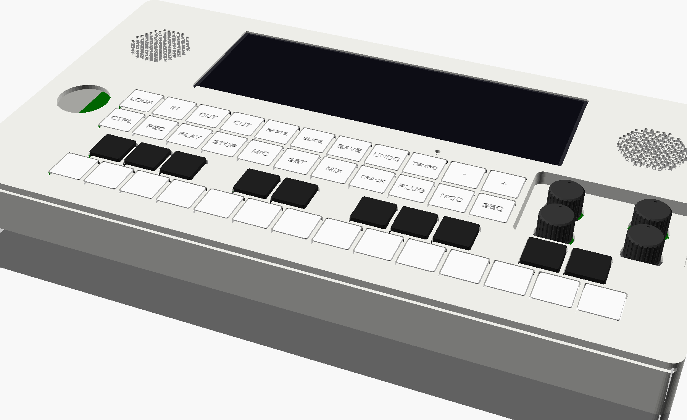
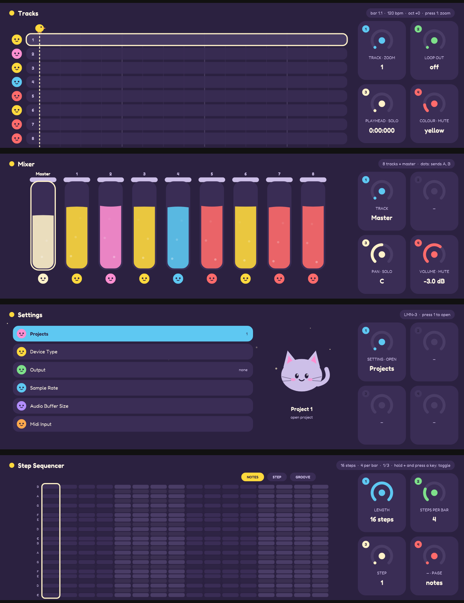
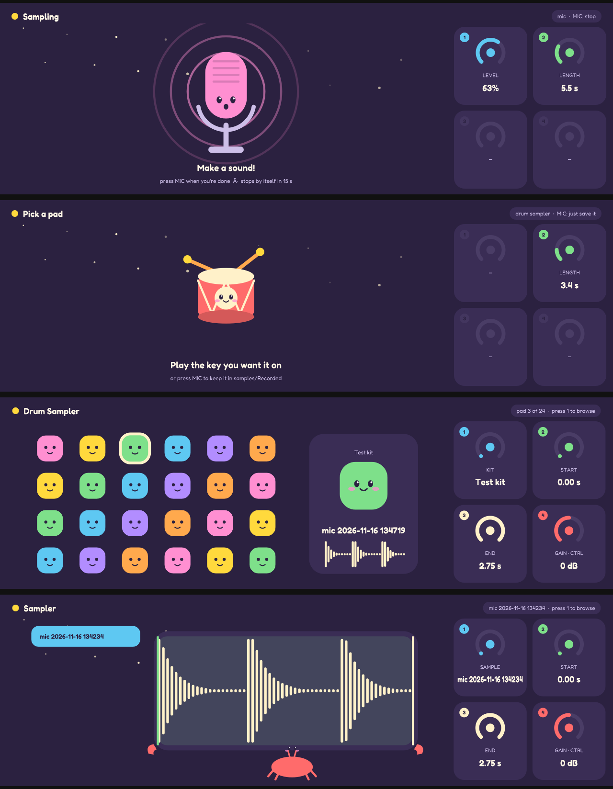
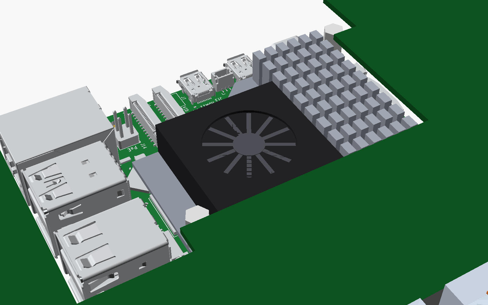
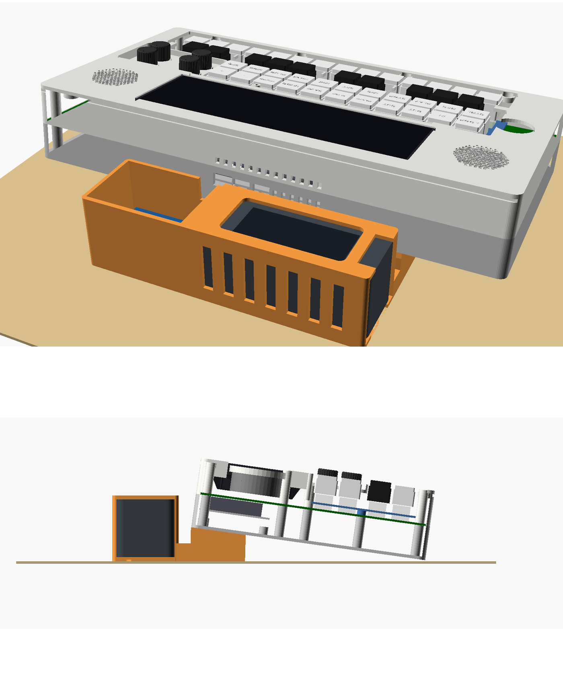

# Limoncello 🍋🎻

**Limoncello is a successor to the [LMN-3](https://github.com/FundamentalFrequency), the open-source DIY groovebox by Fundamental Frequency.** The LMN-3 is a lemon tree; Limoncello is what you make from the lemons, and it ends in *cello*.

It keeps the LMN-3's idea (a Raspberry Pi running a Tracktion-based DAW, a Teensy reading keys and encoders) and rebuilds the instrument around it:

| | Limoncello |
|---|---|
| Keys | 46 **Hall-effect** magnetic switches, **velocity-sensitive**, each with its own **RGB LED** |
| Screen | **7.9" 1280 × 400** bar screen (Waveshare), with DAW screens laid out for it |
| Audio | **Raspberry Pi Codec Zero** on board: two built-in **speakers**, a switched **headphone jack**, a **microphone** |
| Computer | **Raspberry Pi 5** with the official Active Cooler (the board is cut out around it) + **Teensy 4.1** |
| New controls | **MIC** key (record or sample from the mic), **joystick click** (sustain), Control + click (mod wheel on/off) |
| Case | 3D-printed, **flat top**: screen, speakers and keys flush; encoders in a sunken pocket; two lid options |
| Power | mains, or an optional **power bank cradle** (4.5–5 h) |

> **Project status: prototype.** The board, case, firmware and software are designed and checked in CAD and in simulation: design rule checks, interference checks between every part, unit tests, and the app running on a computer. A full Limoncello has **not been built yet**. A 4-key test board is being made to confirm the Hall-effect keys before the main board is ordered. See [What's still open](#whats-still-open).

## Where everything is

| Folder | What's in it |
|---|---|
| [`hardware/main-board/`](hardware/main-board) | The main PCB (rev C, 330 × 180 mm, 2 layers): KiCad project, Gerbers ready for JLCPCB/PCBWay, BOM, pick-and-place, 3D model, key map |
| [`hardware/test-board/`](hardware/test-board) | A 4-key test board and sketch, to try the Hall-effect keys before ordering the big board |
| [`enclosure/`](enclosure) | The printed case: OpenSCAD sources and ready-to-print STLs, the flush-key test piece, the power bank cradle, renders |
| [`firmware/`](firmware) | Teensy 4.1 firmware (PlatformIO): keys, velocity, LEDs, encoders, joystick |
| Software | The DAW lives in its own repository, because it is GPL: **[HotPTgz/lmn-3-daw, branch `lmn3-v3-wide`](https://github.com/HotPTgz/lmn-3-daw/tree/lmn3-v3-wide)** |
| [`docs/`](docs) | The [build guide](docs/BUILD.md), [shopping list](docs/SHOPPING_LIST.md), [software setup](docs/SOFTWARE.md), [controls](docs/CONTROLS.md), [power](docs/POWER.md) and [what has been verified](docs/VERIFICATION.md) |

## Build it

Start with **[docs/BUILD.md](docs/BUILD.md)**. It goes from ordering parts to the first sound, in this order:

1. Try the keys on the **test board** (optional, cheap, recommended).
2. Order the **parts** ([shopping list](docs/SHOPPING_LIST.md)) and the **main board**.
3. **Assemble** the board, flash the **Teensy**.
4. Set up the **Raspberry Pi** and build the **software** ([SOFTWARE.md](docs/SOFTWARE.md)).
5. **Print** and assemble the **case**.

Roughly: $520 of core parts, plus either $200 for factory assembly of the small surface-mount parts or $35 of parts to solder yourself. The battery option is about $90 more.

## A look inside

| | |
|---|---|
|  |  |
| The DAW's screens laid out for the 7.9" bar: the knob boxes sit in a 2 × 2 grid, like the encoders beside the screen | Control + MIC samples a sound straight onto a drum pad or into the sampler |
|  |  |
| The Pi 5 hangs under the board; the board is cut around its cooler, measured from Raspberry Pi's official 3D model | The optional power bank cradle also tilts the instrument 8° towards you |

## What's still open

- **The screen's HDMI cable route.** The Pi's micro-HDMI ports sit at the rear wall, while the screen's HDMI port is inside, so the cable either loops outside the case or goes through a micro-HDMI ribbon kit. Neither is built into the case yet. See [BUILD.md](docs/BUILD.md#the-screens-hdmi-cable).
- **The key gap** (`GAP` in the case) will be set from the flush-key test piece.
- **The joystick height** used for the lids is an estimate. Measure it when you have one.
- **Recording from the mic onto a track** and the app on the real 7.9" screen still need trying on real hardware.

Issues and pull requests are welcome, especially from people who build one.

## Credits and licences

Limoncello stands on the **LMN-3 by [Fundamental Frequency](https://github.com/FundamentalFrequency)**: [LMN-3-ECAD](https://github.com/FundamentalFrequency/LMN-3-ECAD), [LMN-3-DAW](https://github.com/FundamentalFrequency/LMN-3-DAW) and [LMN-3-Firmware](https://github.com/FundamentalFrequency/LMN-3-Firmware). The DAW is built on [Tracktion Engine](https://github.com/Tracktion/tracktion_engine) and [JUCE](https://juce.com).

| Part | Licence |
|---|---|
| Hardware (`hardware/`) and enclosure (`enclosure/`) | [CC BY-SA 4.0](LICENSES/CC-BY-SA-4.0.txt), like the LMN-3 hardware it derives from |
| Firmware (`firmware/`) | [GPL-3.0](firmware/LICENSE), like LMN-3-Firmware |
| Software ([lmn-3-daw fork](https://github.com/HotPTgz/lmn-3-daw)) | GPL-3.0, like LMN-3-DAW |
| `enclosure/source/pi5_official.stl` | Raspberry Pi Ltd's Pi 5 3D model, MIT ([licence](enclosure/source/pi5_official.LICENSE.txt)) |

Raspberry Pi is a trademark of Raspberry Pi Ltd. Waveshare, UGREEN, Gateron and the other product names belong to their owners; they are named only to say which parts fit.
