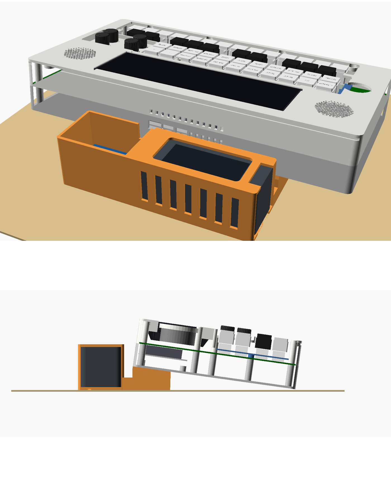

# Power

Everything in Limoncello runs from the Raspberry Pi 5's 5 V rail: the Pi, the screen (USB-C from the Pi), the Teensy and Hall sensors, the 46 LEDs, the Codec Zero and the speaker amp.

## How much it draws (estimates)

| Part | Typical | Peaks |
|---|---|---|
| Pi 5 running the DAW + Active Cooler | 5–7 W | ~11 W |
| 7.9" screen | ~2 W | ~3 W |
| 46 LEDs, capped at 25 % brightness | ~1 W | ~3.5 W (all white) |
| Speaker amp | ~1 W | ~5 W (loud) |
| Teensy, Hall sensors, Codec Zero | ~1 W | ~1.5 W |
| **Total** | **~11–13 W** | **~20–24 W** |

That's why it needs a **5.1 V 5 A** supply: the official Raspberry Pi 27 W USB-C supply.
- With an ordinary 5 V 3 A (15 W) USB-C charger the Pi still boots, but it limits its USB ports to 600 mA and can brown out on peaks: audio glitches or a sudden shutdown.
- Keep `LED_MAX_BRIGHTNESS` in the firmware low.

## On battery

Power banks and USB chargers give 5 V at no more than 3 A. The fix is a small **USB-PD → 5.1 V 5 A converter**: it asks the bank for 9–20 V and makes the 5 A the Pi wants.

**Recommended set** (see the [shopping list](SHOPPING_LIST.md)):

| Part | Notes |
|---|---|
| UGREEN Nexode Power Bank 20000mAh 130W | 72 Wh: about **4.5–5 h** of playing. Its colour screen shows the live volts, amps and watts. Under the 100 Wh airline limit |
| USB-PD → 5.1 V 5 A converter board | Needs a source of ≥ 27 W at 9 V or more. Any board up to 64 × 46 mm fits the cradle |
| USB-C cable, 10–15 cm | Bank → converter |
| Right-angle USB-C cable, 25–30 cm, 5 A | Converter → Limoncello |

Tell the Pi once that it has 5 A: `sudo rpi-eeprom-config --edit`, add `PSU_MAX_CURRENT=5000`, reboot.

## The cradle

[`enclosure/stl/cradle.stl`](../enclosure/stl/cradle.stl), source [`cradle.scad`](../enclosure/source/cradle.scad):

- **Bank:** it lies in a sleeve behind the case, 10 mm back, so the Pi cooler's exhaust vents stay clear.
  - It slides in from the left, display up; a window on top shows its readout.
  - Its ports face the converter bay. Check that your bank's ports are on the end of the column.
- **Converter bay:** behind the Pi's USB-C.
  - A short cable goes through the divider from the bank to the converter.
  - The output cable comes out of the notch at the top, into the rear USB-C.
- **Tilt:** a wedge under the case's rear edge tilts it **8°** towards you. `TILT` can be anything from 3° to 12°.
- **Fixing:** two M3 × 10 screws go up through the wedge into heat-set inserts in the tray. The tray already has the bosses for them.
- **Printing:** PETG, standing on its base, no supports.

The whole power path was checked in CAD against the tilted case and the parts inside, but it has not been run on a real build yet. Watch the bank's screen the first time.
