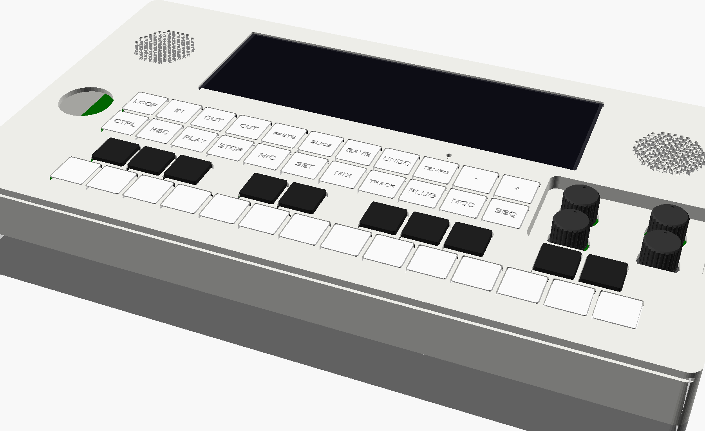

# Limoncello enclosure: flat top

The screen glass, both speaker grilles and the keys are flush with one flat top surface.
- The glass sits 1 mm below the top. A 1 mm lip covers its black border, so a dropped object or the table never touches it.
- The black piano keys stand 1.5 mm proud.
- The 4 encoders sit in a pocket sunk 7 mm into the top. The knobs are 16 mm wide with 12 mm of ribbed side to grip, yet stand only 5 mm above the main surface. The joystick sticks out as before.
- Cooling: vents in the rear wall at board level (air gap under the screen, where the Pi cooler pokes through the PCB) and beside the Pi in the bottom tray, plus slots in the tray floor.
- Two lid options (magnetic, slide-on) cover everything for transport.

Overall size: 337 × 187 mm, 56 mm tall (27 mm above the PCB, 29 mm below it for the Pi 5 and Codec Zero).

All parts were checked against the PCB and parts layout: screen, speakers, encoders, joystick, mic, headphone jack, Teensy, plus the Pi 5, Active Cooler and Codec Zero sized from Raspberry Pi's official STEP model, mechanical drawing and product brief.
- No part collides, with the keys at rest or fully pressed.
- Both lids clear the knobs, the raised keys and the joystick.
- Every part fits the K1 bed (220 × 220).



The `components/` renders show the electronics alone. The Pi 5 is Raspberry Pi's own 3D model (MIT licence, `source/pi5_official.stl`).

**The screen's 3D model is not included**, because Waveshare's licence for it isn't stated. The STLs don't need it; only the renders and the interference checks use it. To use them:
1. Download `7_9inch-side-monitor-case.zip` from the bottom of [Waveshare's 7.9inch Touch Monitor wiki](https://www.waveshare.com/wiki/7.9inch_Touch_Monitor).
2. Convert the STEP inside it: `pip install cadquery-ocp`, then `python3 tools/step2stl.py 7_9inch-side-monitor-case.stp source/screen_waveshare.stl 0.05`.

## Parts to print (`stl/`)
| File | Qty | Material / settings | Notes |
|---|---|---|---|
| `top_left.stl`, `top_right.stl` | 1 each | PLA or PETG, 0.2 mm, 4 walls, 20 % infill | Printed top-down (the flat top on the bed gives a smooth finish). Supports only under the 4 screen corner brackets and the speaker rings, if your slicer asks. |
| `tray_left.stl`, `tray_right.stl` | 1 each | PLA/PETG | Floor on the bed, no supports. |
| `plate_left.stl`, `plate_right.stl` | 1 each | PETG preferred (stiffer clips), 100 % infill | The switches clip into this, as they need a plate. |
| `keys_menu_all.stl` | 1 | **white or translucent** PLA/PETG, 0.12–0.16 mm | All 22 menu keys with engraved labels (LOOP … SEQ). Printed upside down, no supports. |
| `key_white.stl` | 14 | white / translucent | Piano white keys. |
| `key_black.stl` | 10 | black | Piano black keys (1.5 mm taller). |
| `knob.stl` | 4 | any | Push-fit on the EC11 knurled shaft (7 mm engagement). Printed upside down; the dot on top marks the pointer. |
| `lid_mag_left/right.stl` | 1 each | PLA/PETG | Magnetic lid: 8 × (8 × 3 mm) magnets in the lid, 8 in the case. |
| `lid_slide_left/right.stl` | 1 each | PLA/PETG | Slide-on lid: runs in grooves along the front and rear walls, slides on from the right. |
| `cradle.stl` | 1 (optional) | **PETG**, 4 walls, 20 % | Power bank cradle, see below. Prints standing on its base, no supports. |

White or translucent keys let the per-key RGB LEDs glow through the keys and the gaps around them.

## Hardware
- 6 × M3 heat-set inserts (M3 × 5.7 mm) in the top-shell bosses.
- 9 × M3 × 30 screws, all from underneath through the counterbored tray bosses and the PCB:
  - 6 go into the top-shell inserts (corners, (40,66), (285,86));
  - 3 self-tap into the plate legs along the middle row.
- Pi 5 mounting (its four mounting holes; the Active Cooler uses its own two heatsink holes):
  - 1 × M2.5 × 11 mm female-female stand-off between the Pi and the PCB at H12, with 2 × M2.5 × 5 screws.
  - 3 × M2.5 × 6 mm female-female stand-offs, screwed under the Pi's other three holes with 3 × M2.5 × 5 screws from the top. The heads clear the cooler and the GPIO header.
  - 3 × M2.5 × 8 screws from underneath, through the tray posts into those stand-offs. The counterbores fit a 5 mm pan head.
- 4 rubber feet, 10 mm (8 with the power bank cradle).
- Power bank cradle only: 2 × M3 heat-set inserts (M3 × 5.7) in the tray, 2 × M3 × 10 screws.
- Magnetic lid only: 16 × 8 × 3 mm neodymium disc magnets and CA glue. **Check polarity**: lid and case magnets must attract, so mark one face before gluing.
- About 20 cm of 1.75 mm filament, used as dowels in the seam holes. Glue the two halves of each part with CA or plastic cement; the screws to the PCB then hold everything rigid.

## Assembly order
1. Glue the two top halves together (filament dowels in the seam holes), and the two tray halves.
2. Melt in the 6 heat-set inserts. Glue the 8 lid magnets (magnetic version) from below into the pockets under the top skin.
3. Press the speakers into their rings under the grilles, with a drop of glue. Push the mic capsule into the seat at the bottom of the mic tube.
4. PCB: screw the plate halves onto the 3 middle holes, then clip all 46 switches through the plate and press them flat onto the PCB.
5. Fit the Active Cooler and the 3 short stand-offs to the Pi. Plug the Pi (with the H12 stand-off) and the Codec Zero under the PCB and connect the cables. Stick 2–3 pads of 5 mm EVA foam on the PCB under the screen's centre block, behind or to the right of the Pi opening (for example around (140, 64), (190, 64) and (205, 30)). They press the glass up against the lip when the case is closed. Connect the screen's USB-C and HDMI from the right.
6. Lower the top shell over the PCB (the screen drops into its pocket), flip, put the tray on and screw everything from below, including the 3 Pi screws.
7. Push the tiles onto the switches through the top, then the knobs onto the encoders.

## Before printing everything
- **Print the flush-key test piece first** (`flush_test/`): see below.
- **Screen:** placed from Waveshare's own 3D model of the monitor (`7_9inch-side-monitor-case.stp`). What it showed:
  - The active area (191.08 × 60.40 mm) **is centred** on the 211 × 73 mm front, so the window is right as drawn.
  - The module is **21.5 mm deep** at its centre block (98 × 59 mm), not 20. The wings are only 9.8 and 12.5 mm deep. With the glass 1 mm under the top, the back of the centre block sits 4.5 mm above the PCB. It clears the Pi's USB stack by 1.6 mm.
  - **Ports:** USB-C, a smaller 8 × 3.8 mm opening (the HDMI) and the on/off button slot are all on one side wall of the centre block. In this case they face right (+x), 48.5 mm right of the screen centre, 9–13 mm above the PCB. They sit under the right wing, which leaves about 16 mm of height for the plugs.
  - **VESA holes:** the four M4 holes (50 × 50 mm) mostly land over the Pi opening, so they aren't used.

- **Pi 5 ports:** the rear-wall openings come from Raspberry Pi's official Pi 5 STEP model:
  - USB-C at x 180.3–190.3 mm.
  - The two micro-HDMI ports at x 167.6–175.3 and 153.0–161.4 mm. They overhang the Pi's edge by 1.6 mm, into the wall, so the wall is open there. You can also plug a monitor in for setup.
  - The parameters are `PI_USBC_X/Z` and `PI_HDMI_X/Z`.
- **Joystick:** `JOY_PROUD` is my estimate of how far the stick stands above the top. Measure it; the lids use it.
- **Pi cooling:** the Active Cooler stands 10.5 mm above the Pi (official drawing), which leaves only about 0.5 mm below the PCB. So the PCB is open over it, following the cooler's outline, and the blower draws air from the gap under the screen. The rear-wall vents let that air out. Fit the cooler before mounting the Pi under the board.
- **Pi USB-A:** only the **lower** pair of USB ports and Ethernet can take a plug; the PCB covers the upper USB pair.

## Power bank cradle (`stl/cradle.stl`, optional)
Runs the LMN-3 from a **UGREEN Nexode Power Bank 20000mAh 130W** (45.5 × 46 × 115 mm), about 4.5–5 h of playing.
- The bank lies in a sleeve behind the case, so it never blocks the rear vents. Slide it in from the left end, display up: the window on top shows volts, amps and the charge left.
- A **USB-PD → 5.1 V 5 A converter board** sits in the bay at the bank's port end, right behind the Pi's USB-C. The bay fits boards up to about 64 × 46 mm, for example the RegalDream RDv5 (62 × 25 mm) or the common 59 × 44 mm "5V5A PD power expansion board for Pi 5".
- A wedge under the case's rear edge tilts the LMN-3 **8°** towards you (change `TILT` in `cradle.scad`; anything from 3° to 12° works).
- **Fixing it:** two M3 × 10 screws go up through the long holes in the wedge into two M3 heat-set inserts in the tray. The bosses are already in `tray_left/right.stl`. Press the inserts in from inside the tray.
- **Cables:**
  - bank USB-C → converter input: a short (10–15 cm) USB-C to USB-C cable, through the hole in the divider;
  - converter output → the LMN-3's USB-C: a 25–30 cm right-angle USB-C cable rated 5 A (e-marked), out through the notch at the top of the bay.
- **On the Pi**, once: `sudo rpi-eeprom-config --edit`, add `PSU_MAX_CURRENT=5000`, and reboot. Only do this when the converter (or the official 27 W supply) is what powers it.
- **Printing:** print it standing on its base, no supports. Use PETG: the converter gets warm. 4 walls, 20 % infill. Four 10 mm rubber feet go in the recesses underneath.

## Open point: the HDMI cable
The Pi's micro-HDMI ports end 1.6 mm past the case wall line (official STEP). So a plug can only go in from **outside**, through the rear-wall openings. The screen's HDMI is inside, under the right wing. Two ways to connect them:
- A short flat HDMI cable that leaves through the Pi port opening and comes back in through a slot in the rear wall near the screen.
- A micro-HDMI FPC ribbon kit with a 90° plug, plus a small bump on the rear wall to house the plug head, so the ribbon stays inside.

The case doesn't have either yet.

## Flush-key test piece (`flush_test/`)
It fits the 4-key test board (`hardware/test-board/`): it stands on the printed test plate and uses its M2 corner screws (M2 × 35 instead of M2 × 10).
- Each opening has a different gap (0.35 / 0.45 / 0.55 / 0.65 mm, engraved next to it).
- Tiles: 2 white, 1 raised black, 1 menu tile labelled REC.
- Play them and pick the gap that feels right (no rubbing, no wobble). Set `GAP` in `source/lmn3_v3_case.scad` to it, then export the keys and top shell again.

## Editing
Everything is parametric in `lmn3_v3_case.scad`. Positions come from the rev C board (`v3_layout.scad`, generated from the KiCad file). Render one part with:

```
openscad -D 'part="top_left"' -o top_left.stl lmn3_v3_case.scad
```

Useful parameters: `GAP` (key fit), `BLACK_UP`, `KNOB_PROUD`, `LIP_T`, `PANEL_T`, `WALL`.
